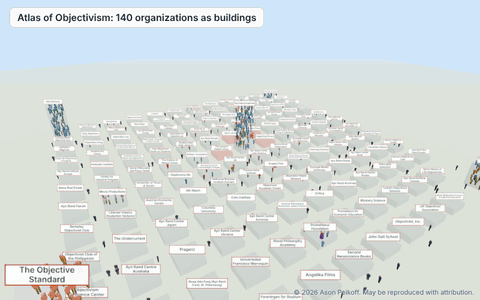

# peikoff.net

A Cloudflare Worker serving the website from `public/` with a D1-backed API.

The homepage is a virtual terminal. Users must enter the correct password
first, then they can run read-only SQLite `SELECT` statements. Query results are
rendered in a table in the page.

## Develop

Install dependencies and start the local Wrangler server:

```sh
npm install
npm run dev
```

Create the D1 database and update `wrangler.toml` with the real `database_id`:

```sh
npx wrangler d1 create whoneedsit
```

Set the Worker secret used by the password gate:

```sh
npx wrangler secret put USER_PASSWORD
```

Important: a GitHub repository variable/secret is not directly available at
Worker runtime. The Worker can only read values configured in Cloudflare for
the Worker itself (Secrets/Vars), or values injected during a deployment step.

The Worker includes `GET /api/tables`, which reads from the `whoneedsit` D1
binding and returns the current table names.

It also includes:

- `POST /api/auth` to verify the password
- `POST /api/query` to execute password-gated read-only `SELECT` SQL against D1

## Deploy

Authenticate with Wrangler, then deploy the Worker:

```sh
npx wrangler login
npm run deploy
```

The Worker forwards non-API requests to the static asset binding. Unmatched
routes fall back to `public/index.html`, so the scaffold also supports
client-side routing.

## Atlas of Objectivism (atlas subdomain)



_Video version (no GIF quirks, 158 s, 800x500): [`public/atlas/tour.mp4`](public/atlas/tour.mp4). The GIF above is 380 px wide; a smaller one (300 px) is [`tour-small.gif`](public/atlas/tour-small.gif). Earlier tours are kept as [`tour-v3.gif`](public/atlas/tour-v3.gif) and [`tour-v2.gif`](public/atlas/tour-v2.gif)._ This tour shows the Peikoff buildings and Amy and Barbara talking, the cottages, skeleton fish, the pirate ship, Midas's plane, the railway and its tunnel, the Atlantis sign, the City Forum lab and Kira. It was rendered before the Culture of Reason Center layout, the guitar, the car lot and the scooter were merged, so the next version will show those.

`atlas.<domain>` is served by this same Worker: requests on that host are rewritten to
`public/atlas/` (the 3D viewer: three.js, no build step) and `/api/*` is not exposed there.
`peikoff.net/atlas/` serves the same files (this is the canonical URL, and it works without the subdomain) and `/atlas` redirects to it.
The homepage has a hover/hide-able link in the top-right corner and a `/atlas` terminal command.

Terminal commands: `/whois`, `/whoare`, `/random`, `/links` (Objectivist links from a static copy of the `websites` table in
`public/links/objectivist.json`, minus sites known to be dead, or the Peikoff links A-Z), `/atlas`. Ctrl+C cancels a pending prompt.
`/data` (D1 query mode) is intentionally unlisted; the Download CSV button only appears once it is unlocked.

### How the data is shown (legend)

Everything in the Atlas comes from a row of the D1 database (`whoneedsit`) or is scenery. Full detail and the mapping rules are in [`atlas/README.md`](atlas/README.md).

| What it is in the data | What you see | Details |
|---|---|---|
| An organization (`orgs`) | A building | One floor per 6 people, minimum 1 floor. Peikoff organizations are red. Defunct ones stay visible for now. |
| A person (`people`) | A walking figure | Stands in their primary organization's building; people with no organization are on the sidewalks. People linked to 2 or more organizations walk between those buildings (door, elevator, street). |
| A live website (`websites`) | A fish swimming in the stream | Color = kind: gold organization, orange Substack, teal personal, green forum/blog, pink store, purple publication. |
| A defunct website | A pale skeleton fish | Its card links only to the archive copy. |
| A social group or community (`social`) | A cottage; size = members | In the mountains: Facebook, LinkedIn, Goodreads, Google Groups, and Reddit (highest up). On the valley floor: Meetup. Door color = platform. |
| Namesake businesses (`namesakes`) | Not separate yet | J. Galt Finance Suite is drawn as an ordinary building for now. |
| Not in the data | Scenery and Easter eggs | Mountains, lake, stream, the Atlantis Railway, Midas Peikoff's plane, the car lot, and a few hidden surprises. Not searchable. |
| Homes and gathering places | Castle, mother-in-law suite, apartment building, Ayn Rand's villa, Ford Hall Forum | Type `/home`, `/speak`, `/salon` or `/work` in the search box. Double click or tap a person to speak with them (registration required; opening soon). |

The viewer lives in `public/atlas/` and its data pipeline (D1 export, layout/route builder in R and Python) in
`atlas/`; see `atlas/README.md`. Refresh the data with `Rscript atlas/export_whoneedsit.R` then
`Rscript atlas/make_whoneedsit.R` (or the `.py` equivalents / `npm run atlas:build`), commit, and `npm run deploy`.
